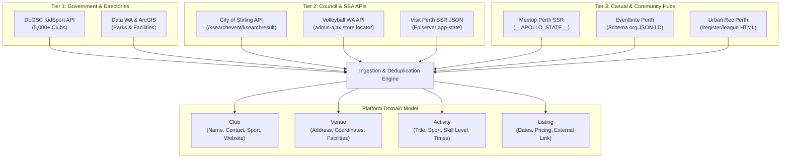

# Perth Amateur & Casual Sports Data Sources Research

**Date**: 2026-11-05  
**Topic**: High-Yield, Technically Viable Data Sources for Amateur and Casual Sports Activities Across Greater Perth  
**Target Domain Model**: Aligns with [GLOSSARY.md](../../GLOSSARY.md) concepts: `Activity`, `Club`, `Venue`, and `Listing`.

---

## 1. Executive Summary & MVP Source Prioritization

Building a Perth sports discovery platform requires aggregating two distinct types of data:
1. **Directory Data (`Clubs` & `Venues`)**: Persistent organizations, affiliated associations, training facilities, and home grounds.
2. **Schedule Data (`Activities` & `Listings`)**: Dynamic, scheduled games, social kickabouts, social league seasons, and casual training sessions with dates, times, skill levels, and registration URLs.

Following empirical inspection of APIs, HTTP responses, bot protections, and schemas across Western Australian sports bodies and portals, data sources have been categorized into four viability tiers.

### MVP Ingestion Priority Matrix

| Rank | Source / Platform | Primary Entities | Data Protocol / Format | Scraping Friction | MVP Recommendation |
| :--- | :--- | :--- | :--- | :--- | :--- |
| **1** | **WA DLGSC KidSport Directory** | `Club`, `Venue` | REST API (JSON) | Very Low (standard browser UA) | **P0 (Must-Have)**: Instant 5,000+ community club directory across Greater Perth. |
| **2** | **City of Stirling Events** | `Activity`, `Listing`, `Venue` | REST API (POST JSON) | Low (JSON endpoint via Kendo UI) | **P0 (Must-Have)**: Direct JSON feeds of beach/leisure community sports. |
| **3** | **Eventbrite Perth Sports** | `Activity`, `Listing`, `Venue` | Schema.org Event JSON-LD / REST v3 | Low (Structured JSON-LD in SSR) | **P0 (Must-Have)**: Highest coverage for one-off casual sports, runs, and tourneys. |
| **4** | **Meetup Perth Sports & Fitness** | `Activity`, `Club`, `Venue`, `Listing` | Next.js SSR `__APOLLO_STATE__` / GraphQL | Low-Medium (SSR state extraction) | **P0 (Must-Have)**: Prime source for casual pick-up games and social kickabouts. |
| **5** | **Volleyball WA Store Locator** | `Club`, `Venue` | WordPress AJAX JSON (`admin-ajax.php`) | Very Low (Direct JSON) | **P1 (High-Yield SSA)**: 65+ volleyball venues, social volley centers & clubs with lat/lng. |
| **6** | **City of Perth VisitPerth** | `Activity`, `Listing`, `Venue` | Optimizely SSR JSON (`#site-search-app-state`) | Low (Pre-rendered JSON payload) | **P1 (High-Yield LGA)**: Inner-city sports and recreation activities. |
| **7** | **Data WA & GeoHubs** | `Venue` | CKAN API / ArcGIS FeatureServer GeoJSON | Very Low (Public Open Data) | **P1 (Venue Baseline)**: Spatial geometry for public parks, ovals, and pavilions. |
| **8** | **Urban Rec Perth** | `Activity`, `Club`, `Venue`, `Listing` | Server-rendered HTML Table | Low (Simple DOM parsing) | **P1 (Casual Leagues)**: Dedicated social multisport, basketball, soccer, netball leagues. |
| **9** | **PlayHQ** | `Activity`, `Club`, `Venue`, `Listing` | GraphQL API (`api.playhq.com/graphql`) | High (WAF + ToU restrictions) | **P2 (Deferred / Selective)**: Premier league fixture data; high maintenance. |
| **10** | **City of Vincent Events** | `Activity`, `Listing`, `Venue` | HTML Scraping (Semantic Cards) | Low | **P2**: Low sports volume, scrape as needed. |
| **11** | **Football West / Squadi** | `Activity`, `Club`, `Listing` | Proprietary Closed App (Squadi) | Very High (No public API) | **P3 (Avoid for MVP)**: Fallback to DLGSC & PlayFootball club directories. |
| **12** | **Facebook Public Events** | `Activity`, `Listing` | Graph API (Gated) / HTML (Anti-bot) | Extreme (Login walls, IP bans) | **P3 (Avoid)**: Not technically viable for automated pipeline. |

---

## 2. In-Depth Analysis of Data Sources

### 2.1 WA Government & Directory Portals

#### 2.1.1 WA Department of Local Government, Sport and Cultural Industries (DLGSC)
* **Primary Source URL**: [https://kidsport.dlgsc.wa.gov.au/find-a-club/](https://kidsport.dlgsc.wa.gov.au/find-a-club/)
* **Direct API Endpoint**: `https://kidsport.dlgsc.wa.gov.au/api/find-a-club-search/`
* **Underlying Architecture**: Microsoft Dynamics 365 Power Pages / Dynamics CRM.
* **Coverage**: Statewide Western Australia (~5,000 sports clubs), covering Greater Perth LGAs extensively.
* **Sports Covered**: Australian Rules Football, Soccer, Basketball, Netball, Tennis, Cricket, Volleyball, Martial Arts, Swimming, Athletics, Gymnastics, Rugby, etc.
* **Data Format**: Unauthenticated REST JSON API.
* **Technical Ingestion Mechanism**:
  ```http
  GET /api/find-a-club-search/?basic=true&keyword=&page=1&count=50 HTTP/1.1
  Host: kidsport.dlgsc.wa.gov.au
  User-Agent: Mozilla/5.0 (X11; Linux x86_64) AppleWebKit/537.36
  ```
  Advanced parameters supported: `suburb`, `LocalGovernmentId` (UUID), `sportId` (UUID), `season`, `ExtendArea`.
* **Field Mapping to Domain Model**:
  - `Club.name` $\leftarrow$ `Name` / `RegisteredName`
  - `Venue.address` $\leftarrow$ `StreetAddress` / `PostalAddress`, `Suburb`
  - `Venue.coordinates` $\leftarrow$ `Latitude`, `Longitude`
  - `Club.contact` $\leftarrow$ `Email`, `Phone`, `Website`, `Facebook`
  - `Listing.age_group` $\leftarrow$ `ageGroups` (`at0to12`, `at13to18`, `at19to30`, `at31to50`, `at51to99`)
* **Constraints & Ingestion Feasibility**:
  - Protected by Azure Application Gateway WAF (`Microsoft-Azure-Application-Gateway/v2`); requests without a realistic browser `User-Agent` receive HTTP 403. With browser headers, it returns clean JSON.
  - No authentication or session cookies required.
  - Trailing slash is mandatory (`/api/find-a-club-search/`); missing slash issues HTTP 301.
  - Rate limits: Moderate. Batching pages of 50-100 items with 1-second delays is highly feasible and non-intrusive.

#### 2.1.2 Data WA & Local Government GeoHubs
* **Primary Source URLs**:
  - [Data WA Catalogue](https://catalogue.data.wa.gov.au/)
  - [City of Perth GeoHub](https://geohub-perth.opendata.arcgis.com/)
* **Direct API Endpoints**:
  - CKAN Action API: `https://catalogue.data.wa.gov.au/api/3/action/package_search`
  - City of Perth Parks: `https://geohub-perth.opendata.arcgis.com/datasets/perth::parks-1`
* **Coverage**: Spatial infrastructure, parks, sporting reserves, ovals, and pavilions across Perth councils (City of Perth, City of Joondalup, City of Melville, City of Stirling).
* **Data Format**: CKAN JSON, GeoJSON, Shapefiles, and Esri ArcGIS FeatureServer REST endpoints.
* **Ingestion Feasibility**: 100% open public data (Creative Commons Attribution). Ideal for seeding the `Venue` master database with exact polygons and coordinates.

---

### 2.2 Local Council Event Portals (Greater Perth LGAs)

#### 2.2.1 City of Stirling
* **Primary Source URL**: [https://www.stirling.wa.gov.au/attractions-and-recreation/arts-and-events/events-calendar](https://www.stirling.wa.gov.au/attractions-and-recreation/arts-and-events/events-calendar)
* **Direct API Endpoint**: `https://www.stirling.wa.gov.au/ksearchevent/ksearchresult`
* **Underlying Architecture**: Kentico / AgencyWeb with Kendo UI client-side rendering.
* **Coverage**: City of Stirling LGA (Scarborough, Trigg, Balcatta, Mirrabooka, Inglewood, Osborne Park). Includes beach sports, recreational runs, leisure centre activities, and community sports carnivals.
* **Data Format**: REST API returning JSON (`Data`, `Total`, `AggregateResults`).
* **Technical Ingestion Mechanism**:
  A POST request with specific JSON headers:
  ```http
  POST /ksearchevent/ksearchresult HTTP/1.1
  Host: www.stirling.wa.gov.au
  Content-Type: application/json
  SearchParam: [{"key":"classname","values":["AWPT.Event"],"or":"true","operator":"eq"},{"key":"searchindexes","values":["Events"],"or":"true","operator":"eq"},{"key":"nodealiaspath","values":["/"],"or":"true","operator":"eq"},{"key":"FilterIsExpired","values":["false"],"or":"true","operator":"eq"}]
  SearchFilter: []
  User-Agent: Mozilla/5.0 (X11; Linux x86_64)

  {"page": 1, "pageSize": 50, "skip": 0, "take": 50}
  ```
* **Payload Fields**:
  - `ArticleTitle`: Activity name.
  - `ArticleSummary`: Activity description.
  - `ArticleAddressTitle`: Venue location.
  - `ArticleCategories`: Category tags (e.g., Sport, Community, Leisure).
  - `EventDisplayDate`: Human-readable date range.
  - `PageUrl`: Relative path to detail listing.
* **Constraints**: Requires the custom `SearchParam` and `SearchFilter` headers. Exposes ~100-200 live community events at any given time.

#### 2.2.2 City of Perth (Visit Perth)
* **Primary Source URL**: [https://www.visitperth.com/events/](https://www.visitperth.com/events/)
* **Underlying Architecture**: Optimizely (Episerver) CMS behind Cloudflare.
* **Coverage**: Inner-city Perth, Northbridge, East Perth, West Perth, Elizabeth Quay, Kings Park.
* **Data Format**: Pre-rendered JSON in HTML script tag (`<script type="application/json" id="site-search-app-state">`).
* **Technical Ingestion Mechanism**:
  Fetching `https://www.visitperth.com/events/?page=N` returns a script block containing:
  ```json
  {
    "results": {
      "results": [
        {
          "properties": {
            "Name": "Event Title",
            "Url": "/events/sample-event/",
            "Summary": "Event description...",
            "Categories": ["Sport", "Active"],
            "Location": "Kings Park",
            "Latitude": -31.96,
            "Longitude": 115.84,
            "Date": "2026-11-10",
            "Time": "08:00 AM"
          }
        }
      ],
      "totalRecords": 120,
      "pageSize": 10
    }
  }
  ```
* **Constraints**: Cloudflare bot protection requires a standard modern browser TLS handshake and User-Agent. Scraping frequency should be low (e.g., daily cron) since city events do not churn hourly.

#### 2.2.3 City of Vincent
* **Primary Source URL**: [https://www.vincent.wa.gov.au/events/](https://www.vincent.wa.gov.au/events/)
* **Underlying Architecture**: OpenCities CMS.
* **Coverage**: Vincent LGA (Leederville, Mount Lawley, Highgate, North Perth).
* **Data Format**: Semantic HTML cards (`<article>`, `.event-dates`, `.location-info`).
* **Technical Ingestion Mechanism**: Standard HTML parsing using Cheerio / BeautifulSoup.
* **Constraints**: Relatively low sports-specific volume (focuses more on arts, community workshops, library sessions). Useful as an auxiliary source.

---

### 2.3 State Sporting Associations (SSAs) & League Platforms

#### 2.3.1 PlayHQ (Basketball WA, Netball WA, AFL Auskick & PFL, Cricket WA)
* **Primary Source URLs**:
  - Main Portal: [https://www.playhq.com](https://www.playhq.com)
  - Basketball WA Hub: [https://www.playhq.com/basketball-wa](https://www.playhq.com/basketball-wa)
  - Perth Metro Basketball League (PMBL): [https://www.playhq.com/basketball-wa/org/perth-metro-basketball-league-pmbl/32dfaa96](https://www.playhq.com/basketball-wa/org/perth-metro-basketball-league-pmbl/32dfaa96)
  - WABL: [https://www.playhq.com/basketball-wa/org/western-australian-basketball-league-wabl/b929d1c9](https://www.playhq.com/basketball-wa/org/western-australian-basketball-league-wabl/b929d1c9)
* **Underlying Architecture**: Single Page Application (React) communicating with Apollo GraphQL microservices:
  - `GRAPH_ENDPOINT`: `https://api.playhq.com/graphql`
  - `SEARCH_ENDPOINT`: `https://search.playhq.com/graphql`
  - `SPECTATOR_ENDPOINT`: `https://spectator.playhq.com/graphql`
  - `SPECTATOR_WS_ENDPOINT`: `wss://spectator.playhq.com/graphql`
* **Internal GraphQL Schema Structure**:
  Empirical inspection of bundle `/assets/index.8c33f1de.js` reveals explicit GraphQL fragments:
  ```graphql
  fragment DateFixtureFragment on DiscoverDateFixture {
    games {
      id
      alias
      pool { id name }
      away { ...RoundFixtureTeamFragment }
      home { ...RoundFixtureTeamFragment }
      date
      dates
      status { name value }
      allocation {
        time
        dateTimeList { date time }
        court {
          id
          name
          latitude
          longitude
          venue {
            id
            name
            abbreviatedName
            address
            suburb
            state
            postcode
            country
            latitude
            longitude
          }
        }
      }
    }
  }
  ```
* **Coverage**: Dominant platform for structured amateur leagues in Perth (basketball, netball, community AFL, grassroots cricket).
* **Ingestion Constraints & Feasibility**:
  - **Bot Mitigation**: AWS CloudFront WAF blocks requests without full browser headers or with TLS fingerprint discrepancies.
  - **Legal / Terms of Use**: PlayHQ's Terms of Use explicitly restrict automated extraction or reproduction of fixture and player data without written authorization.
  - **Partner API**: PlayHQ provides an official Tech API (`docs.playhq.com/tech`) requiring tenant keys (`x-api-key`, `x-phq-tenant`).
  - **Recommendation**: Defer full league fixture scraping for MVP. Instead, use PlayHQ organization URLs as external referral links (`Listing.external_url`) attached to `Clubs` discovered via DLGSC.

#### 2.3.2 Volleyball WA (VWA)
* **Primary Source URL**: [https://volleyballwa.com.au/places/find-a-club/](https://volleyballwa.com.au/places/find-a-club/)
* **Direct API Endpoint**: `https://volleyballwa.com.au/wp-admin/admin-ajax.php?action=store_search`
* **Underlying Architecture**: WordPress on WP Engine with WP Store Locator plugin. League competitions run on RevolutioniseSPORT.
* **Coverage**: 65+ volleyball locations across Greater Perth (Inner City Beach The HUB, Loftus, Lords, Cockburn ARC, local affiliate clubs).
* **Data Format**: Direct JSON.
* **Technical Ingestion Mechanism**:
  ```http
  GET /wp-admin/admin-ajax.php?action=store_search&lat=-31.95&lng=115.86&max_results=100&search_radius=100 HTTP/1.1
  Host: volleyballwa.com.au
  User-Agent: Mozilla/5.0 (X11; Linux x86_64)
  ```
* **Returned Fields**:
  - `store`: Club or facility name.
  - `address`, `address2`, `city`, `state`, `zip`: Full physical address.
  - `lat`, `lng`: Exact venue coordinates.
  - `hours`: HTML table of weekly social volley / open court times.
  - `url`: Direct referral link.
  - `terms`: Category ("Social Volley Centre", "Affiliated Club").
* **Ingestion Feasibility**: Very high. Open AJAX endpoint, fast response, no API key required.

#### 2.3.3 Football West
* **Primary Source URLs**:
  - Official Site: [https://footballwest.com.au](https://footballwest.com.au)
  - National Club Finder: [https://playfootball.com.au](https://playfootball.com.au)
* **Underlying Architecture**: Competition administration and match-day draws are hosted on **Squadi** (`squadi.com`, by World Sport Action).
* **Data Format**: Closed mobile/web app ecosystem; no public API or feed.
* **Ingestion Feasibility**: Very low for fixtures. For club discovery, soccer clubs should be ingested via DLGSC KidSport API or by scraping the national PlayFootball directory.

---

### 2.4 Social, Casual, and Pick-Up Sports Platforms

#### 2.4.1 Eventbrite Perth (Sports & Fitness)
* **Primary Source URL**: [https://www.eventbrite.com.au/d/australia--perth/sports--events/](https://www.eventbrite.com.au/d/australia--perth/sports--events/)
* **Direct API**: Eventbrite REST API v3 (`https://www.eventbriteapi.com/v3/events/search/`).
* **Coverage**: Extensive for casual sports tournaments, social running clubs, charity bike rides, martial arts workshops, yoga in parks, and amateur competitions.
* **Data Format**:
  1. **Schema.org JSON-LD**: Embedded on every public search and event detail page (`@type: ItemList` containing `@type: Event` with `startDate`, `endDate`, `name`, `description`, `location`, `url`).
  2. **REST API v3**: Returns clean paginated JSON using an Eventbrite Private API Token.
* **Ingestion Feasibility**: Extremely high. Schema.org JSON-LD can be parsed directly from HTML responses without API token quotas, or ingested via standard Eventbrite developer credentials.

#### 2.4.2 Meetup Perth (Sports & Active Life)
* **Primary Source URL**: [https://www.meetup.com/find/?location=au--perth&categoryId=652](https://www.meetup.com/find/?location=au--perth&categoryId=652) (Category 652: Sports & Fitness)
* **Underlying Architecture**: Next.js Server-Side Rendered (SSR) with Apollo Client.
* **Coverage**: Active grassroots casual groups across Greater Perth (e.g., Kings Park walking & running, social basketball scrimmage at McCallum Park, casual badminton, beach volleyball at Scarborough, road cycling).
* **Data Format**:
  - Public web page embeds `<script id="__NEXT_DATA__">` with complete `__APOLLO_STATE__`.
  - Also provides Schema.org Event JSON-LD on individual activity pages.
  - Official GraphQL API: `https://api.meetup.com/gql` (requires OAuth / Pro subscription).
* **Technical Ingestion Mechanism**:
  Fetching the search page and extracting `JSON.parse($('script#__NEXT_DATA__').html()).props.pageProps.__APOLLO_STATE__` yields all `Event` objects with:
  - `title`: Activity name.
  - `dateTime`: ISO 8601 timestamp with Perth timezone (`+08:00`).
  - `venue`: `Venue` name, street address, city, country.
  - `group`: Sponsoring `Club`.
* **Constraints**: Moderate Cloudflare rate limiting; scraping should use friendly interval spacing (e.g. 5-10 second delays between paginated categories).

#### 2.4.3 Urban Rec Perth
* **Primary Source URL**: [https://perth.urbanrec.com.au/register/league](https://perth.urbanrec.com.au/register/league)
* **Coverage**: Inner Perth casual leagues (Bob Hawke College, Subiaco, Perth Modern, Leederville). Sports include Multisport (dodgeball, kickball, handball), Basketball, Soccer, Netball, Touch Football.
* **Data Format**: Static, server-rendered HTML `<table>`.
* **Fields**: League name, Skill Level (e.g., "Recreational"), Venue name, Season start date & duration (e.g., "09 Nov 2026, 6 weeks"), Game time window (e.g., "6:15 PM - 8:30 PM, Monday"), Price, Registration link.
* **Ingestion Feasibility**: Very high. Clean markup, no complex anti-scraping mechanisms, high relevance for casual players wanting social teams.

#### 2.4.4 Facebook Public Events
* **Platform**: Meta Graph API / Facebook Web.
* **Technical Assessment**:
  - Meta deprecated public event search in Graph API v3.3+.
  - Accessing public events on Pages requires Page Public Content Access (PPCA) approval under Meta App Review.
  - Direct web scraping is barred by aggressive device fingerprinting, mandatory login interstitials, IP blacklisting, and explicit Terms of Service prohibitions.
* **Conclusion**: **Unviable for MVP automated pipeline**. If community organizers submit Facebook Event links manually, they can be accepted as user submissions.

---

## 3. Data Ingestion Architecture & Entity Mapping

To integrate these disparate sources into a unified Perth sports discovery database, the ingestion pipeline should normalize data into the project domain model:



### Attribute Normalization Rules

1. **Venue Resolution & Geo-Clustering**:
   - Multiple activities take place at common sports complexes (e.g., *Lords Recreation Centre*, *Bob Hawke College*, *Scarborough Beach Amphitheatre*, *Bendat Basketball Centre*).
   - Normalize addresses using Landgate / Data WA spatial data, clustering venues within 50 meters to avoid duplicate venue records.
2. **Date & Timezone**:
   - Western Australian Standard Time (AWST) is UTC+08:00 year-round (no daylight saving).
   - Ingestion parsers must explicitly anchor naive timestamps to `Australia/Perth` / `+08:00`.
3. **Skill Level Standardization**:
   - Extract keywords from summaries: `Beginner`, `Social`, `Recreational`, `Casual`, `Intermediate`, `Open`, `Competitive`.
4. **Referral Attribution**:
   - Always preserve the originating URL in `Listing.external_url` to direct users to the official registration or ticket page.

---

## 4. Scraping & Ingestion Constraints Summary

| Data Source | Rate Limit Guidance | Header Requirements | Anti-Bot Technology | Legal & Terms Considerations |
| :--- | :--- | :--- | :--- | :--- |
| **DLGSC KidSport** | Max 2 req/sec | Browser User-Agent mandatory | Azure App Gateway WAF | Public government directory. Informational use compliant with WA open access principles. |
| **City of Stirling** | Max 1 req/sec | `SearchParam` + `SearchFilter` JSON headers | Cloudflare / Kentico | Public civic events calendar. Cache responses for 12-24 hours. |
| **City of Perth (Visit Perth)** | Max 1 req/2 sec | Standard Browser User-Agent | Cloudflare | Civic tourism calendar. Respect robots.txt crawl-delay. |
| **Volleyball WA** | Max 2 req/sec | None | WP Engine / Cloudflare | Public club locator plugin. Low request volume needed (single sweep of 100km radius). |
| **Eventbrite** | Standard API limit (1,000/hr) or 1 req/sec (HTML) | Standard User-Agent | Cloudflare / PerimeterX | Schema.org microdata designed specifically for indexers and search aggregators. |
| **Meetup** | Max 1 req/3 sec | Standard Browser User-Agent | Cloudflare | Public browse pages. Avoid high concurrency. Cache for 6-12 hours. |
| **Urban Rec Perth** | Max 1 req/5 sec | None | Cloudflare | Small site (7 sport categories). Scraped cleanly in under 10 HTTP requests. |
| **PlayHQ** | Do not mass scrape | Browser headers + origin | CloudFront WAF | Strict Terms of Use prohibit automated extraction. Use partner APIs for deep sync. |

---

## 5. MVP Action Plan & Next Steps

1. **Phase 1: Seed Master Club & Venue Directory (Day 1)**
   - Ingest DLGSC KidSport API (`/api/find-a-club-search/`) to populate 3,000+ Greater Perth `Clubs` and `Venues` with exact coordinates and contact information.
   - Run the Volleyball WA store locator sweep for dedicated volleyball venues.
   - Pull City of Perth / City of Joondalup open spatial datasets from Data WA for public sports pavilions and grounds.

2. **Phase 2: Ingest Scheduled Casual Activities & Leagues (Day 2)**
   - Deploy scrapers for Meetup Perth Sports (`__APOLLO_STATE__`) and Eventbrite Perth Sports (Schema.org JSON-LD).
   - Ingest City of Stirling (`/ksearchevent/ksearchresult`) and Visit Perth (`#site-search-app-state`) community events.
   - Ingest Urban Rec Perth leagues table (`/register/league`).

3. **Phase 3: Automated Sync & Refresh Pipeline (Day 3)**
   - Configure a daily cron / scheduled task to refresh dynamic event listings (Meetup, Eventbrite, Council events).
   - Set weekly refresh for club directories (DLGSC, Volleyball WA).
